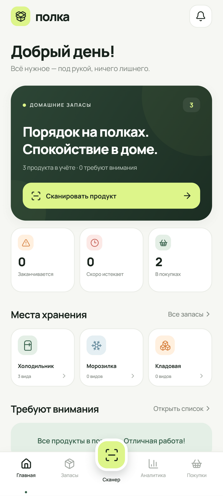
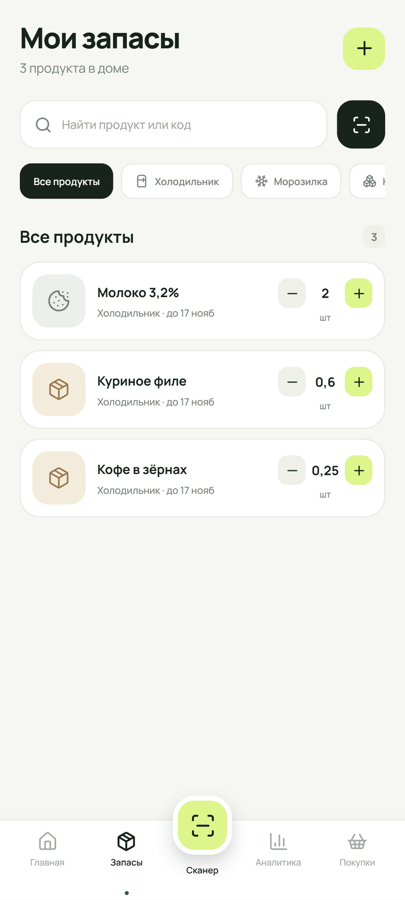
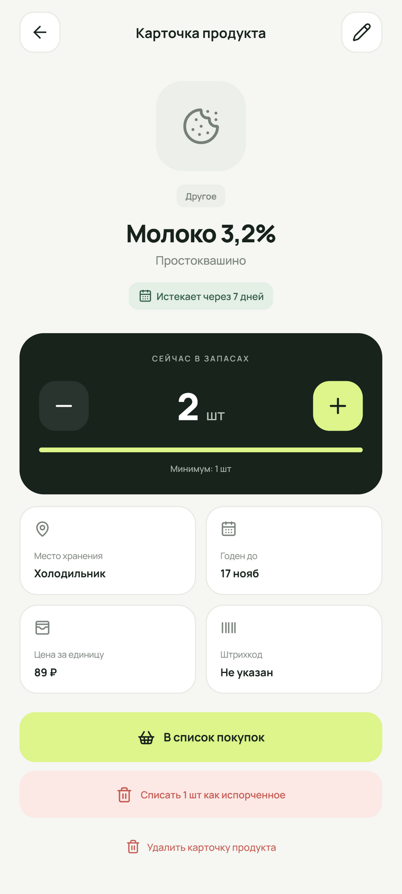
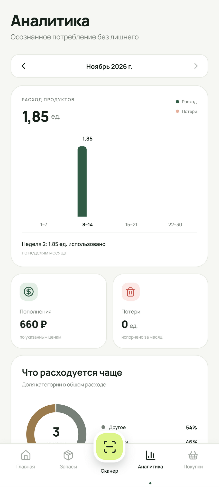
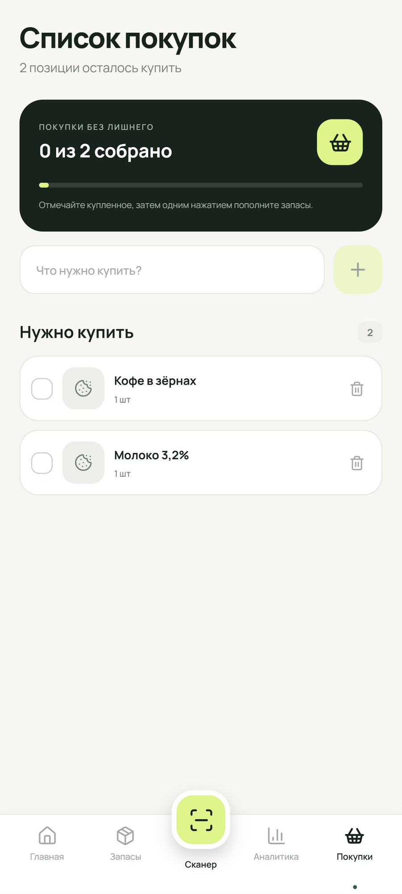
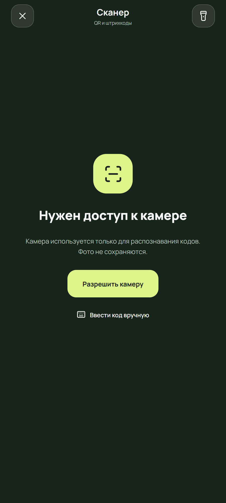

# Local Home Inventory

Мобильное приложение «Полка» для учёта продуктов дома: запасы, сроки годности, сканер QR- и штрихкодов, список покупок и месячная аналитика расхода.

Проект построен на **Expo SDK 58**, **React Native** и **TypeScript**. Приложение работает офлайн, хранит данные на устройстве и подходит для Android, iOS и web.


## Возможности

- Учёт продуктов по категориям и местам хранения: холодильник, морозилка, кладовая.
- Название, бренд, количество, единица измерения, цена, минимальный запас и срок годности.
- Поиск и фильтры по месту хранения, состоянию запаса и срокам годности.
- Быстрые действия `+` и `−` прямо в списке продуктов.
- Сканер QR, EAN-13, EAN-8, UPC, Code 128, Code 39 и ITF-14.
- Локальное распознавание уже сохранённых кодов без интернета.
- Поиск неизвестных товарных штрихкодов в Open Food Facts.
- Ручной ввод кода, если камера недоступна или код плохо читается.
- История операций: пополнение, расход и списание испорченных продуктов.
- Аналитика за месяц: недельный расход, потери, стоимость пополнений и категории.
- Список покупок с переносом купленного обратно в домашние запасы.
- Современный адаптивный интерфейс с поддержкой безопасных зон и accessibility-ролями.
- Фирменная иконка и настройки Android adaptive icon.

## Скриншоты

Экраны сняты на web-сборке в мобильном разрешении. Данные на изображениях — демонстрационные; при первом запуске приложение начинается с пустой базы.

<table>
  <tr>
    <td></td>
    <td></td>
    <td></td>
  </tr>
  <tr>
    <td align="center">Главная</td>
    <td align="center">Запасы</td>
    <td align="center">Карточка продукта</td>
  </tr>
  <tr>
    <td></td>
    <td></td>
    <td></td>
  </tr>
  <tr>
    <td align="center">Аналитика</td>
    <td align="center">Покупки</td>
    <td align="center">Сканер</td>
  </tr>
</table>

## Технологии

- Expo и Expo Router
- React Native 0.88
- TypeScript в strict-режиме
- AsyncStorage для локального хранения
- Expo Camera для распознавания кодов
- Open Food Facts API для поиска неизвестных штрихкодов
- React Native SVG для диаграммы категорий
- Lucide React Native для иконок
- Manrope как основной шрифт
- ESLint и Expo Doctor для контроля качества

## Запуск

Требуется Node.js и npm.

```bash
npm install
npx expo start --go
```

Для запуска на Android через Expo Go:

1. Установите Expo Go на телефон.
2. Подключите телефон и компьютер к одной Wi-Fi сети.
3. Отсканируйте QR-код из терминала.

Если устройство не видит сервер:

```bash
npx expo start --go --tunnel
```

Для запуска web-версии:

```bash
npm run web
```

Для Android-эмулятора после установки Android Studio:

```bash
npm run android
```

## Проверка качества

```bash
npm run lint
npm run typecheck
npx expo-doctor
npx expo export --platform all
```

Текущее состояние: линтер и TypeScript проходят без ошибок, Expo Doctor проходит все проверки, production-экспорт собирается для Android, iOS и web. Физическая камера и виброотклик требуют проверки на реальном устройстве.

## Как устроен проект

```text
src/
  app/                 Экраны Expo Router
    (tabs)/            Главная, запасы, аналитика и покупки
    product/[id].tsx   Карточка продукта
    product-form.tsx   Создание и редактирование продукта
    scanner.tsx        Сканер кодов
  components/          Интерфейсные компоненты
  context/             Состояние и локальное хранение
  data/                Справочники категорий, мест и единиц
  types/               Типы предметной области
  utils/               Даты, аналитика, запасы и поиск продуктов
assets/
  screenshots/         Изображения для README
```

Основной поток сканирования:

1. Камера распознаёт строку кода на устройстве.
2. Приложение ищет её среди сохранённых продуктов.
3. Если код не найден и похож на товарный штрихкод, выполняется запрос к Open Food Facts.
4. Данные предзаполняют форму нового продукта.
5. Подтверждённая операция записывается в историю и используется в аналитике.

## Хорошие стороны

- **Офлайн-first:** основные сценарии работают без сервера и аккаунта.
- **Полный пользовательский цикл:** продукт можно добавить, отсканировать, использовать, списать, купить и вернуть в запасы.
- **Аналитика основана на событиях:** история операций позволяет строить месячные отчёты и расширять их без изменения модели данных.
- **Быстрый сценарий сканирования:** известный код сразу открывает продукт и не требует ручного поиска.
- **Понятная архитектура:** маршруты, компоненты, состояние и вычисления разделены по отдельным директориям.
- **Типобезопасность:** strict TypeScript снижает количество ошибок при развитии проекта.
- **Адаптивность:** интерфейс работает на телефоне, планшете и в браузере.
- **Доступность:** ключевые действия имеют accessibility-роли и подписи.
- **Небольшой внешний контур:** сторонний сетевой сервис используется только как необязательный источник сведений о штрихкодах.

## Недостатки и ограничения

- **Нет автоматического резервного копирования:** данные привязаны к устройству; экспорт, импорт и синхронизация отсутствуют.
- **Нет напоминаний:** приложение не отправляет push-уведомления о сроках годности и низких остатках.
- **Зависимость от внешней базы:** Open Food Facts может не знать часть продуктов, работать медленно или быть недоступен без интернета.
- **QR-коды не всегда идентифицируют продукт:** произвольный URL или текст нельзя однозначно сопоставить с товаром.
- **Аналитика суммирует разные единицы:** штуки, килограммы, граммы и литры отображаются как условные «ед.».
- **Нет автоматической конвертации единиц:** 500 г и 0,5 кг не приводятся к единому значению.
- **Ограниченная обработка дубликатов:** одинаковые или похожие карточки не объединяются автоматически.
- **Нет учётной записи и общего доступа:** несколько членов семьи не могут сейчас вести одну базу.
- **Минимальная история интерфейса:** события используются в аналитике, но отдельного детального журнала операций пока нет.
- **Нет автоматических тестов:** есть линт, typecheck, Expo Doctor и production-экспорт, но unit- и E2E-тесты не добавлены.
- **Нативная функциональность проверена частично:** камера и haptics требуют ручного тестирования на Android и iOS.

## Направления развития

- Экспорт, импорт и резервное копирование данных.
- Синхронизация между устройствами и семейный доступ.
- Push-уведомления о сроках годности и минимальных остатках.
- Полноценный журнал операций с поиском и отменой действий.
- Нормализация и конвертация единиц измерения.
- Обработка дубликатов и слияние карточек продуктов.
- Unit- и E2E-тесты.
- Улучшенный нативный выбор даты.
- Кэширование результатов Open Food Facts для офлайн-поиска.

## Лицензия

Проект распространяется по лицензии MIT. Подробности в [LICENSE](LICENSE).
